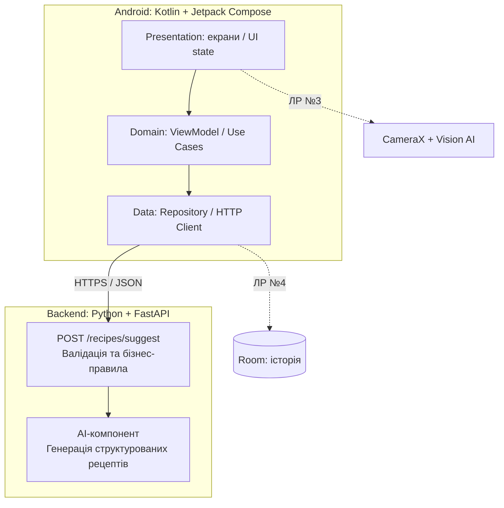

# Fridgy — концепція мобільного AI-застосунку

> **Статус:** концепція, лабораторна робота №1. Описані нижче функції ще не означають, що вони реалізовані.
>
> **Робочий слоган:** *Cook smarter. Waste less. Eat better.*

## 1. Загальна інформація

- **Назва:** Fridgy.
- **Індустрія:** FoodTech; суміжні сфери — споживчі сервіси й екологія (зменшення харчових відходів).
- **Платформа:** нативний Android-застосунок.
- **Основна аудиторія:** студенти, молоді фахівці, люди, які живуть самостійно, пари та невеликі домогосподарства.
- **Основна проблема:** користувачеві складно щодня вирішувати, що приготувати з уже придбаних продуктів, враховуючи наявний час, уподобання та обмежений бюджет. Частину продуктів забувають використати.
- **Рішення:** мобільний AI-помічник, який на основі підтверджених користувачем інгредієнтів і побажань пропонує невеликий набір реалістичних страв, позначає відсутні інгредієнти та надає покрокову інструкцію.

## 2. Передумови вибору ідеї

Під час обговорення можливих ідей розглянуто декілька напрямів мобільних AI-продуктів:

| Концепція | Ключова користь | Обмеження для початкового MVP |
|---|---|---|
| SnapDo | Перетворення скріншотів на корисні дії | Декілька типів інтеграцій і сценаріїв |
| Fitly | Підбір образів із власного гардероба | Потрібне початкове наповнення каталогу одягу |
| DayQuest | Гейміфікація щоденних звичок | Складність перевірки реальної користі |
| LAYER | Нотатки, прив'язані до фізичних об'єктів | Повноцінний AR складний на старті |
| **Fridgy** | **Швидкий вибір страв із доступних продуктів** | **Можна почати з одного зрозумілого AI-сценарію** |

Fridgy обрано через щоденну актуальність проблеми, можливість почати з ручного введення інгредієнтів і природний розвиток до роботи з камерою, локальною базою, покупками й харчовими залишками.

## 3. Візія, ціннісна пропозиція та межі

**Візія:** зробити вибір страви простою дією, а домашні продукти — основою персоналізованих рекомендацій.

**Унікальна ціннісна пропозиція:** «Відкрий Fridgy, зазнач продукти й час — отримай 2–3 конкретні варіанти, які можна приготувати зараз, без довгого пошуку рецептів».

Fridgy не позиціонується як медичний сервіс і не замінює професійних дієтологічних рекомендацій. AI не гарантує безпеку продуктів або точність їхньої придатності за фото.

### 3.1. Користувацькі сценарії

1. **Fridgy NOW (головний сценарій).** Введення інгредієнтів, часу й побажань → генерація 2–3 варіантів → вибір рецепта → перегляд кроків.
2. **Fridgy Rescue (після MVP).** Користувач зазначає, що хоче використати певний продукт раніше → AI надає йому пріоритет у рекомендаціях. Інформацію про безпечність використання людина перевіряє самостійно.
3. **Fridgy Loop (після MVP).** Користувач підтверджує використані інгредієнти після приготування → кількості оновлюються → наступні рекомендації враховують зміни.
4. **Fridgy Cook (після MVP).** Покроковий режим приготування з таймерами й варіантами заміни інгредієнтів.
5. **Fridgy Chain (подальший розвиток).** Пропозиції декількох взаємопов'язаних страв, які дозволяють розумно використати придбані продукти.

### 3.2. Основний сценарій першого MVP

**Вхід:** «Яйця, помідори, сир; 15 хвилин; 1 порція; без м'яса».

**Дія:** Android-застосунок надсилає введені параметри на backend; сервер перевіряє їх і викликає AI-компонент.

**Вихід:** 2–3 короткі варіанти страв зі зрозумілими назвами, орієнтовним часом, списком інгредієнтів, позначкою відсутніх продуктів та покроковим описом. Наприклад, «Омлет із помідорами та сиром».

**Критерій успіху:** користувач бачить структуровані рекомендації або зрозуміле повідомлення про помилку; некоректні й порожні дані обробляються без аварійного завершення.

## 4. Платформа й технологічний стек

| Компонент | Пропонована технологія | Призначення |
|---|---|---|
| Android UI | Kotlin, Jetpack Compose, Material 3 | Екрани та взаємодія |
| Архітектура mobile | MVVM + розділення Presentation / Domain / Data | Зрозуміла структура й тестованість |
| Мережевий шар | Retrofit / OkHttp, Kotlin Serialization або Moshi | HTTP-взаємодія та JSON |
| Backend | Python, FastAPI, Pydantic | Контракт API, валідація, обробка помилок |
| AI | Зовнішня LLM через серверний API | Структуровані рекомендації рецептів |
| Локальні дані (ЛР №4) | Room | Історія запитів і результатів |
| Камера (наступний етап) | CameraX + Vision AI | Розпізнавання видимих продуктів із фото |

**Архітектурне рішення:** зовнішній AI викликає **backend**, а не мобільний клієнт. Ключі API зберігаються в конфігурації сервера, не в APK і не в Git.

Альтернативи: XML UI замість Compose, Ktor Client замість Retrofit, інша серверна технологія замість FastAPI. Для курсового проєкту вибрано поширений стек із простою інтеграцією та документацією.

## 5. Концептуальна архітектура



### 5.1. Потік даних

1. Людина додає продукти та параметри, натискає «Що приготувати?».
2. ViewModel перевіряє базові значення та встановлює стан `loading`.
3. Repository надсилає JSON на `POST /recipes/suggest`.
4. FastAPI перевіряє вхід через Pydantic і формує запит до AI.
5. Backend перевіряє структуру відповіді, виділяє відсутні інгредієнти й повертає валідний JSON.
6. Android показує страви або стан помилки та можливість повторити запит.
7. Починаючи з ЛР №4, успішний запит і результат додатково зберігаються в Room.

### 5.2. Планований API-контракт (уточнюється під час ЛР №2)

```json
{
  "ingredients": ["яйця", "помідори", "сир"],
  "max_time_minutes": 15,
  "servings": 1,
  "preferences": ["без м'яса"]
}
```

Результат: об'єкт із масивом `recipes`, де кожен рецепт містить `title`, `estimated_minutes`, `ingredients`, `missing_ingredients`, `steps`, а також `warnings` за потреби. Формат є попереднім; точні поля та умови валідації визначаються в ЛР №2.

## 6. Основні функціональні вимоги

| ID | Вимога «Система повинна…» | Пріоритет | Етап |
|---|---|---|---|
| FR-01 | Дозволяти вводити список доступних інгредієнтів | Must | MVP |
| FR-02 | Дозволяти зазначати максимально доступний час приготування | Must | MVP |
| FR-03 | Передавати вхідні параметри до backend через HTTP API | Must | ЛР №2 |
| FR-04 | Повертати до трьох структурованих рекомендацій страв | Must | ЛР №2 |
| FR-05 | Показувати час, склад, відсутні інгредієнти та кроки рецепта | Must | ЛР №2 |
| FR-06 | Відображати стани початку, завантаження, успіху й помилки | Must | ЛР №2 |
| FR-07 | Дозволяти повторно виконати запит без перезапуску застосунку | Must | ЛР №2 |
| FR-08 | Підтримувати аналіз зображення продуктів із підтвердженням списку | Should | ЛР №3 / далі |
| FR-09 | Зберігати успішні AI-запити та результати локально й показувати історію | Must | ЛР №4 |
| FR-10 | Дозволяти відкривати деталі та видаляти записи історії | Must | ЛР №4 |
| FR-11 | Дозволяти вести підтверджуваний інвентар продуктів | Could | Після MVP |
| FR-12 | Пропонувати використання продуктів, які користувач хоче використати раніше | Could | Після MVP |
| FR-13 | Формувати список покупок для відсутніх інгредієнтів | Could | Після MVP |
| FR-14 | Мати режим покрокового приготування з таймерами | Could | Після MVP |

## 7. Нефункціональні вимоги та безпека

- **NFR-01 — Надійність.** Невалідні дані та помилки AI не повинні аварійно завершувати застосунок.
- **NFR-02 — Прозорість.** Результати AI позначаються як рекомендації, а не перевірені рецепти із гарантованими характеристиками.
- **NFR-03 — Приватність.** Надсилати тільки введені або свідомо вибрані дані; фото не передавати без дії користувача.
- **NFR-04 — Захист секретів.** Не розміщувати ключі AI API, токени або приватні конфігурації в Git чи мобільному клієнті.
- **NFR-05 — UX.** Головний сценарій має бути доступним із головного екрана; великі кнопки й читабельні повідомлення.
- **NFR-06 — Офлайн.** Якщо мережі немає, застосунок показує помилку. Із ЛР №4 історія успішних результатів доступна локально після перезапуску.
- **NFR-07 — Харчова безпека.** Не робити висновків про придатність, токсичність, алергени чи гарантії приготування лише за фото. Повідомляти, що склад і ступінь готовності потрібно перевіряти.
- **NFR-08 — Мінімізація даних.** Не вимагати облікового запису на етапі базового MVP.

## 8. Граничні випадки (edge cases)

| Ситуація | Очікувана поведінка |
|---|---|
| Порожній список продуктів | Пояснити, що треба ввести хоча б один продукт |
| Дубльований інгредієнт | Нормалізувати або усунути дубль |
| Дуже малий ліміт часу | Повідомити про обмеження або запропонувати дуже простий варіант, не обіцяючи неможливого |
| AI запропонував відсутній продукт | Явно показати його в `missing_ingredients` |
| Мережа чи backend недоступні | Завершити loading, показати помилку та кнопку повтору |
| Помилковий JSON від backend | Не падати, повідомити про неможливість обробки |
| Фото неоднозначне | Запросити підтвердження розпізнаних інгредієнтів |
| Обмеження в харчуванні | Не гарантувати відсутність алергенів; просити перевірити упаковку та склад |

## 9. Acceptance criteria (Given / When / Then)

- **AC-01.** Given користувач ввів «яйця, сир, помідори» і 15 хвилин, When натискає «Що приготувати?», Then застосунок показує результат із назвою страви, приблизним часом, інгредієнтами та кроками або коректну контрольовану помилку.
- **AC-02.** Given список продуктів порожній, When користувач надсилає запит, Then застосунок показує валідаційне повідомлення і не виконує некоректний HTTP-запит.
- **AC-03.** Given backend недоступний, When виконується генерація, Then стан завантаження завершується й доступна повторна спроба.
- **AC-04 (ЛР №4).** Given результат успішно отриманий і збережений у Room, When застосунок повністю закрито й відкрито знову, Then запис є в історії та відкривається в деталях.


## 10. Ризики та припущення

- AI може вигадувати продукти, час або кроки → JSON-валидація, явний список відсутніх інгредієнтів, тестування.
- Користувачі не захочуть вести повний інвентар → ручний швидкий ввід залишається базовим сценарієм.
- Фото не дає достовірної інформації про кількість, свіжість чи алергени → підтвердження користувача, застереження.
- Зовнішній AI API може бути платним або недоступним → backend має контрольовано обробляти помилки та передбачати тестові відповіді для локального тестування.
- Існують сервіси підбору рецептів → Fridgy концентрується на мінімальній кількості дій, використанні залишків і повторюваному сценарії «що приготувати зараз».

## 11. Промпт для Gemini (вимога методички)

> Я студентка, розробляю концепцію Android Native AI-застосунку в індустрії FoodTech. Назва Fridgy. Цільова аудиторія — студенти, молоді люди та невеликі домогосподарства. Основна проблема — щоденний вибір страви з наявних продуктів. Користувач вводить інгредієнти, час і побажання, а AI через FastAPI пропонує 2–3 структуровані рецепти. Майбутні функції: розпізнавання продуктів камерою, локальна історія, пріоритет продуктів, що треба використати раніше. Підготуй concept.md із проблемою, цінністю, цільовою аудиторією, MVP, архітектурою Presentation/Domain/Data/AI, Mermaid-діаграмою, вимогами, ризиками і розмежуванням MVP та post-MVP. Не видавай заплановані функції за реалізовані.

**Підтвердження виконання:** скріншот реальної розмови з Gemini потрібно додати до звіту; текст вище — підготовлений промпт, а не твердження, що сесію проведено.

---

**Автор:** Шиндерук Тетяна.  
**GitHub:** https://github.com/tshynderuk/Fridgy.
