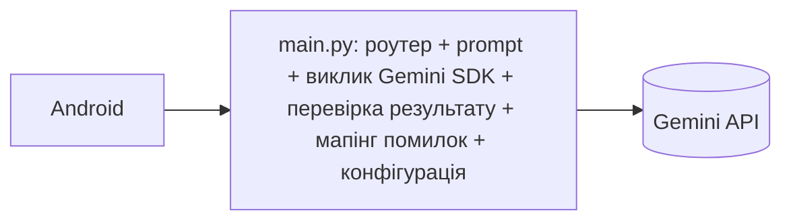
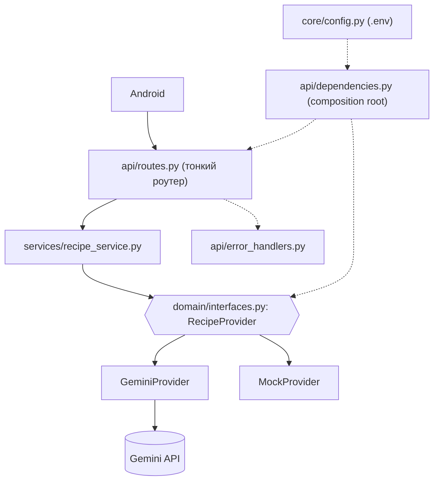

# Architecture — Fridgy

## 1. Загальний опис

Fridgy — нативний Android-застосунок для генерації рецептів на основі продуктів, які є у користувача.

Архітектура складається з трьох основних частин:
- Mobile Application — Android-застосунок (включно з локальним сховищем історії).
- Backend API — серверна частина для обробки запитів.
- AI Component — генерація рецептів за допомогою Google Gemini.

## 2. Технологічний стек

### Mobile Application
- Kotlin.
- Android SDK.
- Jetpack Compose.
- Material Design 3.
- MVVM.
- Kotlin Coroutines.
- StateFlow / Flow.
- Retrofit.
- Gson.
- Room (локальна база даних, ЛР4) з генерацією коду через KSP.

### Backend
- Python.
- FastAPI.
- Pydantic.
- Google GenAI SDK.
- Uvicorn.
- Python-dotenv.
- pytest та httpx (автоматизовані тести, ЛР5).

### AI
- Google Gemini API.
- Структурована генерація JSON.
- Валідація результатів генерації.

## 3. Архітектура мобільного застосунку

### Presentation Layer

Відповідає за інтерфейс користувача та взаємодію з ним.

Основні компоненти:
- MainActivity — точка входу в Android-застосунок.
- FridgyApp — простий перемикач екранів (головний / історія / деталі) без бібліотеки Navigation.
- FridgyStartScreen — головний екран застосунку, реалізований через Jetpack Compose.
- HistoryScreen — екран історії: завантаження, порожній стан, список, видалення з підтвердженням.
- DetailsScreen — екран деталей обраного запису історії.
- RecipeViewModel — обробка дій користувача, керування станом головного екрана та збереження успішного результату в історію.
- HistoryViewModel — надає екранам потік записів історії та окремий запис для деталей.
- RecipeUiState — стани головного екрана.
- DetailsState — стани екрана деталей.

Основні стани головного екрана:
- Idle — початковий стан.
- Loading — очікування генерації рецептів.
- Success — успішне отримання рецептів.
- Error — помилка під час виконання запиту.

### Data / Network Layer

Забезпечує комунікацію мобільного застосунку з Backend.

Основні функції:
- Формування HTTP-запиту.
- Передавання списку продуктів.
- Передавання максимального часу приготування.
- Отримання JSON-відповіді.
- Перетворення відповіді на Kotlin-моделі.
- Передавання результату до ViewModel.

Для HTTP-комунікації використовується Retrofit (RecipeRepository, FridgyApi, RetrofitClient).

### Data / Local Layer (ЛР4)

Забезпечує постійне зберігання історії на пристрої. Backend і AI-компонент не змінювалися.

Ланцюжок: **DAO → Repository → ViewModel → Screen**. Екрани не звертаються до бази напряму.

Компоненти (пакет `com.example.fridgy.data.local` та `data`):
- HistoryEntity — один запис історії (таблиця `history_entries`).
- HistoryDao — запити до бази: список (Flow), читання одного запису, додавання, видалення одного запису, очищення.
- AppDatabase — база Room `fridgy.db`, версія схеми 1.
- HistoryRepository — шар між DAO та ViewModel; серіалізація результату в JSON (Gson) і назад.

## 4. Backend Architecture

Backend реалізований на Python з використанням FastAPI. Після рефакторингу (ЛР5) файл `backend/main.py` є лише точкою входу, що збирає застосунок; уся логіка винесена в пакет `backend/fridgy/`. Команда запуску не змінилася: `uvicorn main:app`.

### Структура

```
backend/
├── main.py                       # точка входу: app, lifespan, підключення роутера, обробників помилок і middleware
├── fridgy/
│   ├── api/
│   │   ├── routes.py             # GET /health, POST /recipe (тонкий роутер)
│   │   ├── schemas.py            # Pydantic RecipeRequest / RecipeResponse + перетворення на доменні моделі
│   │   ├── dependencies.py       # composition root (Depends): settings, provider, service
│   │   ├── error_handlers.py     # помилки домену -> HTTP-відповіді
│   │   └── middleware.py         # X-Request-ID
│   ├── services/
│   │   └── recipe_service.py     # сценарій: виклик провайдера, таймаут, бізнес-правила
│   ├── domain/
│   │   ├── models.py             # RecipeQuery, Recipe
│   │   ├── errors.py             # категорії помилок
│   │   └── interfaces.py         # RecipeProvider (Protocol)
│   ├── infrastructure/providers/
│   │   ├── gemini_provider.py    # справжній Gemini (єдине місце з AI SDK)
│   │   └── mock_provider.py      # підробка для тестів і демонстрації
│   └── core/
│       ├── config.py             # Settings, load_settings (.env)
│       └── request_context.py    # request_id, фільтр журналу, налаштування логування
└── tests/                        # автоматизовані тести без мережі та API-ключа
```

### Відповідальність шарів

| Шар | Відповідає за | Не знає про |
|---|---|---|
| api (routes, schemas) | Приймання запиту, схеми JSON, виклик сервісу, повернення відповіді | Gemini, бізнес-правила |
| api/error_handlers | Перетворення помилок домену на HTTP-коди й повідомлення | Деталі SDK |
| api/dependencies | Єдине місце створення залежностей (composition root) | Бізнес-логіку |
| services | Сценарій «отримати три валідні рецепти»: таймаут і бізнес-правила | HTTP, FastAPI, Gemini SDK |
| domain | Моделі, категорії помилок, інтерфейс RecipeProvider | Усе зовнішнє |
| infrastructure/providers | Реалізації RecipeProvider: GeminiProvider і MockProvider | HTTP-коди |
| core | Конфігурація (.env) і контекст запиту | Прикладну логіку |

### Інтерфейс і дві реалізації

`RecipeProvider` (typing.Protocol) має один метод `generate(query) -> list[Recipe]`. Реалізації:
- **GeminiProvider** будує prompt, викликає Google GenAI SDK, розбирає відповідь і перетворює технічні помилки SDK на категорії домену. Типи SDK не виходять за межі цього файлу.
- **MockProvider** повертає три тестові рецепти без мережі або кидає помилку, передану в конструктор. Рецепти мають `source = "mock"`.

Вибір реалізації відбувається лише в `api/dependencies.py` за змінною `AI_PROVIDER` (`gemini` або `mock`) у `backend/.env`. У тестах реалізацію підміняє `app.dependency_overrides`.

### Помилки

| Помилка домену | HTTP |
|---|---|
| ProviderNotConfiguredError | 503 |
| ProviderUnavailableError | 503 |
| ProviderQuotaExceededError | 429 |
| ProviderTimeoutError | 504 |
| InvalidProviderResponseError | 502 |
| ProviderError (інші) | 502 |

Технічні подробиці записуються в журнал сервера; користувач отримує зрозуміле повідомлення без stack trace. Некоректні вхідні дані, як і раніше, повертають HTTP 422.

### API Endpoints

| Метод | Endpoint | Призначення |
|---|---|---|
| GET | /health | Перевірка доступності сервера |
| POST | /recipe | Генерація трьох рецептів |

Кожна відповідь має заголовок `X-Request-ID` (див. API Contract).

## 5. AI Component

AI-компонент використовує Google Gemini API для створення рецептів.

На вхід передаються:
- Список доступних продуктів.
- Максимальний час приготування.

AI формує три альтернативні варіанти страв українською мовою.

Кожен рецепт містить:
- Назву страви.
- Час приготування.
- Список інгредієнтів із кількістю.
- Послідовність кроків приготування.
- Джерело генерації.

Backend перевіряє структуру відповіді, обов'язкові поля та відповідність часу приготування встановленому обмеженню.

API Key зберігається на сервері у файлі `.env` і не передається мобільному застосунку.

AI-компонент реалізовано як `GeminiProvider` за інтерфейсом `RecipeProvider`. Бізнес-правила перевірки результату (рівно три рецепти, унікальні назви, від 3 до 10 кроків, час не більший за ліміт) виконує `RecipeService`, а не провайдер.

## 6. Потік даних (Data Flow)

1. Користувач вводить продукти та максимальний час приготування.
2. FridgyStartScreen передає введені дані до RecipeViewModel.
3. ViewModel виконує базову перевірку введення й змінює стан інтерфейсу на Loading.
4. Мережевий шар формує HTTP POST-запит до Backend.
5. FastAPI приймає запит; Pydantic (RecipeRequest) перевіряє й нормалізує дані; схема перетворюється на доменний RecipeQuery.
6. Роутер викликає RecipeService, створений через Depends.
7. RecipeService викликає RecipeProvider (GeminiProvider або MockProvider) із таймаутом.
8. GeminiProvider надсилає запит до Google Gemini і перетворює відповідь на доменні Recipe.
9. RecipeService перевіряє бізнес-правила (рівно три рецепти, унікальні назви, 3–10 кроків, час не більший за ліміт).
10. Роутер перетворює Recipe на RecipeResponse і повертає JSON; помилки домену перетворює error_handlers. Кожна відповідь має заголовок X-Request-ID.
11. Android отримує відповідь і перетворює її на Kotlin-моделі.
12. ViewModel перевіряє, що отримано рівно три рецепти. Після цієї перевірки результат вважається валідним.
13. **Єдина точка збереження:** RecipeViewModel викликає HistoryRepository.saveSuccessful(...), який додає новий запис у Room.
14. ViewModel оновлює стан на Success.
15. Jetpack Compose відображає три рецепти користувачеві.

Гілки помилок (HTTP-помилка, відсутність мережі, некоректна відповідь) у базу нічого не записують.

Читання історії: HistoryScreen підписується на Flow зі списком записів із Room і оновлюється автоматично після додавання чи видалення.

## 7. Локальне зберігання (ЛР4)

### Що зберігається

Один успішний запит до AI = один рядок у таблиці `history_entries`:

| Поле | Тип | Призначення |
|---|---|---|
| id | Long, автоінкремент | Локальний ідентифікатор; кожен запуск додає новий рядок |
| createdAt | Long | Час отримання результату (мілісекунди) |
| inputSummary | String | Продукти користувача (скорочено до 150 символів) |
| maxTimeMinutes | Int | Ліміт часу із запиту |
| resultSummary | String | Назви трьох страв для списку |
| recipesJson | String | Повний результат (три рецепти) у форматі JSON |
| status | String | Стан запису; зараз завжди «ready» |

Принцип: зберігаються факти (вхід, результат, час). Форматування дати, підписи на кшталт «Варіант 1 із 3» обчислюються під час показу.

### Що свідомо не зберігається

- API-ключі, токени та інші секрети.
- Помилки Backend та технічні тексти помилок.
- Неповні або невалідні відповіді AI.
- Запити без результату (мережева помилка).

### Де зберігається

У внутрішньому сховищі застосунку на пристрої (файл бази `fridgy.db`). Дані залишаються після повного закриття застосунку. Користувач може видалити один запис або очистити всю історію з екрана історії (обидві дії з підтвердженням). Видалення застосунку також видаляє базу.

### Розподіл за типами сховищ

| Дані | Сховище |
|---|---|
| Записи історії | Room |
| Тимчасовий стан екрана | StateFlow у ViewModel |
| Налаштування користувача, фото | Не використовуються в поточній версії |

## 8. Обробка помилок

Архітектура передбачає обробку помилок на декількох рівнях.

**Mobile:**
- Помилка мережевого з'єднання.
- Таймаут запиту.
- Некоректна відповідь сервера.
- Відповідь із HTTP-помилкою.
- Помилка запису в історію не блокує показ рецептів: користувач усе одно бачить результат.

**Backend:**
- Некоректні вхідні дані — HTTP 422.
- Вичерпання квоти Gemini — HTTP 429.
- Помилка AI — HTTP 502.
- Недоступність AI — HTTP 503.
- Таймаут — HTTP 504.

Мобільний застосунок повинен відображати зрозуміле повідомлення замість аварійного завершення роботи.

## 9. Мережева взаємодія

Під час тестування на Android Emulator використовується адреса:

`http://10.0.2.2:8000/`

Адреса `10.0.2.2` забезпечує доступ емулятора до локального сервера комп'ютера.

Backend запускається окремо від Android-застосунку.

## 10. Поточні обмеження архітектури

- Для генерації потрібне підключення до інтернету.
- Робота AI залежить від доступності Google Gemini API та його квот.
- Backend і мобільний застосунок запускаються окремо.
- Поточна реалізація зосереджена на генерації рецептів, а не на повноцінному управлінні продуктовими запасами.
- Автоматичне відновлення квоти Gemini не реалізовано.
- Історія зберігається лише на пристрої; синхронізації між пристроями немає.
- Запити без мережі не зберігаються для подальшої відправки (підвищений рівень ЛР4 не реалізований).
- Класифікація помилок Gemini у GeminiProvider ґрунтується на пошуку підрядків у тексті помилки SDK (наприклад, «503», «UNAVAILABLE», «429», «RESOURCE_EXHAUSTED»). Вона ізольована в одному місці, але залишається крихкою.
- Провайдер вибирається вручну через `AI_PROVIDER`; резервного провайдера на випадок збою Gemini немає.
- Залежності створюються вручну (без DI-фреймворку); провайдер зберігається в одній змінній процесу.

## 11. Статус реалізації

Основний сценарій інтеграції Mobile → Backend → Gemini → Mobile реалізований.

Перевірено:
- Передавання продуктів із мобільного застосунку.
- Генерацію трьох варіантів рецептів.
- Відображення результатів у мобільному інтерфейсі.
- Обробку помилки HTTP 429.
- Збереження успішних результатів у Room, перегляд історії та деталей, видалення записів, збереження даних після перезапуску.
- Відсутність запису в історії після помилки Backend.
- Backend після рефакторингу (ЛР5): 65 автоматизованих тестів без мережі проходять; Swagger із MockProvider повертає три рецепти з `source = "mock"`; наскрізний сценарій з Android працює з GeminiProvider; технічна помилка конфігурації перетворюється на контрольовану відповідь.

## 12. Архітектура backend до і після рефакторингу (ЛР5)

**Варіант:** Б (FastAPI backend). **Сценарій:** генерація трьох рецептів (`POST /recipe`).

### До

Увесь сценарій виконувався в одному файлі `backend/main.py` (версія до коміту `7618f49`; переглянути можна командою `git show 4a59838:backend/main.py`).



### Після



### Проблеми початкової реалізації (докази в коді)

| № | Проблема | Де було (main.py до рефакторингу) | Підтверджено | Що зроблено |
|---|---|---|---|---|
| 1 | Конкретний AI SDK використовувався напряму, без інтерфейсу; клієнт створювався глобально | `gemini_client = genai.Client(...)` на рівні модуля; виклик `gemini_client.aio.models.generate_content(...)` у `generate_recipe_with_gemini` | Так | SDK перенесено в `GeminiProvider` за інтерфейсом `RecipeProvider` |
| 2 | Одна функція одночасно будувала prompt, викликала SDK, розбирала відповідь і перевіряла бізнес-правила (три різні рецепти, 3–10 кроків, час ≤ ліміту) | `generate_recipe_with_gemini` | Так | Prompt і розбір відповіді в `GeminiProvider`, правила в `RecipeService` |
| 3 | Endpoint сам вирішував, яку помилку повернути, шукаючи підрядки в тексті винятку | `if "503" in error_text or "UNAVAILABLE" in error_text:` у `get_recipe` | Так | Категорії помилок у `domain/errors.py`, перетворення на HTTP в `api/error_handlers.py` |
| 4 | Прикладну логіку неможливо перевірити без реального Gemini | Залежність від глобального `gemini_client` | Так | Залежності передаються ззовні; тести з `MockProvider` і fake-клієнтом |
| 5 | Налаштування (ключ, модель, таймаут) розміщені глобальними змінними разом із кодом застосунку | `GEMINI_API_KEY`, `GEMINI_MODEL`, `AI_TIMEOUT_S` на початку `main.py` | Частково (розкиданість по різних файлах не підтверджена) | `core/config.py` |
| 6 | Прикладна логіка залежить від `HTTPException` | `HTTPException` був лише в endpoint, логіка кидала `ValueError`/`RuntimeError` | Не підтверджено | Без змін |

### Результат

- `main.py` скоротився до 43 рядків: лише збирання застосунку.
- Зовнішня залежність (Gemini) винесена за інтерфейс `RecipeProvider` з двома реалізаціями.
- Залежності передаються через `Depends`; реалізація змінюється лише в composition root.
- Контракт API (`GET /health`, `POST /recipe`, формат JSON) і команда запуску не змінилися; Android-код не змінювався.
